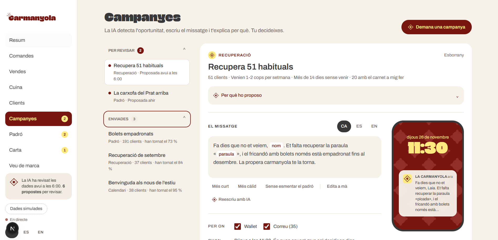

# La Carmanyola

Un restaurant de cuina catalana per emportar al Poblenou (Barcelona)… que no existeix. **La Carmanyola** és un restaurant fictici i tota la seva plataforma digital: la web on es fan les comandes, un carnet de fidelitat que viu al wallet del mòbil i un panell on la IA proposa i l'amo decideix.

El restaurant és inventat, però la programació és real: els pagaments passen per Stripe (en mode de prova), el carnet és una targeta d'Apple i Google Wallet de veritat i els avisos s'envien de debò. L'únic que és simulat són els clients: unes 400 persones amb sis mesos de comandes, perquè el panell tingui dades amb què treballar.

> Projecte de portfolio. El cas d'estudi és a [`docs/cas-estudi.md`](docs/cas-estudi.md).



---

## Què hi ha

### La web, per als clients

Pensada per al mòbil: la majoria de gent hi arriba escanejant el QR de l'envàs.

- **La carta** en català, castellà i anglès, amb la fitxa de cada plat, els al·lèrgens i, si l'amo l'ha omplerta, la informació nutricional.
- **Fes-te'l tu**: tries el plat, la guarnició, els acompanyaments i la salsa.
- **Comanda i pagament** amb hora de recollida. En acabar, un tiquet en PDF i un QR únic per a la comanda.
- **El padró d'ingredients**: quins ingredients de temporada hi ha ara, quins arriben aviat i les novetats que anuncia el restaurant.

### El carnet de desbowlitzador

El programa de fidelitat, sense app. És una targeta al wallet del mòbil.

- Cada comanda directa recupera una paraula del diccionari de la casa: *bowl → carmanyola*, *topping → picada*, *foodie → bona forquilla*…
- Amb les **vuit paraules**, unes postres de regal, i el carnet torna a començar.
- La paraula se suma escanejant el QR de la faixa que tanca cada envàs.
- Qui té el carnet rep l'avís de **l'hora del Què Queda**: el que ha quedat a la cuina a l'última mitja hora de cada servei.

### El panell de l'amo

On el restaurant es gestiona, i on treballa la IA.

- **Resum** del dia i **comandes** en curs.
- **Vendes i franges**: què es ven, quan i quines hores van més fluixes.
- **Clients**: qui fa dies que no ve, qui és nou i qui s'ha adormit.
- **Campanyes**: la IA en proposa i les redacta; l'amo les revisa, les aprova i surten a l'hora programada.
- **Què Queda**: la previsió del que sobrarà i l'avís per als clients amb carnet.
- **Cuina**: el full de producció de demà, per imprimir.
- **Padró**: les altes i baixes d'ingredients de temporada.
- **Carta**: preus, descripcions, fotos, al·lèrgens i disponibilitat, i els canvis surten a la web a l'instant.
- **Veu de marca**: el to del restaurant, que també és el que segueix la IA en escriure.

Tot el que proposa la IA surt en targetes grogues; el que ja és de l'amo, en blanc. El panell també es pot fer servir en català, castellà o anglès.

---

## Com treballa la IA

La IA aquí és una ajudant, no qui mana. Quatre regles:

1. **Els números els calcula la base de dades; la IA només els explica i redacta.** Així no s'inventa cap xifra.
2. **L'amo sempre aprova.** No s'envia res sense un clic seu, i es pot desfer.
3. **Cada proposta diu per què**, amb les dades que la justifiquen.
4. **Funciona sense IA.** Si el model no respon, el panell fa servir textos de plantilla amb els mateixos números.

A més, a la IA no li arriba cap dada personal dels clients: només xifres agregades.

---

## Tecnologia

| Per a què | Què |
|---|---|
| Web i panell | [Next.js](https://nextjs.org) i TypeScript |
| Estils | Tailwind CSS |
| Idiomes | next-intl (català, castellà i anglès) |
| Base de dades, usuaris i fitxers | [Supabase](https://supabase.com) (Postgres) |
| Pagaments | Stripe, en mode de prova |
| Carnet | Apple Wallet i Google Wallet |
| Correu | Resend |
| IA | Gemini, de Google |
| Allotjament | Vercel |

---

## Com executar-lo

Cal tenir instal·lats **Node.js 20 o més nou**, **Docker** i la **CLI de Supabase**.

```bash
npm install          # instal·la les dependències
npm run db:start     # arrenca la base de dades en local
npm run db:seed      # hi posa la carta, el padró, la veu de marca i l'usuari de l'amo
npm run sim:seed     # crea els clients i els mesos de comandes simulades
npm run dev          # arrenca l'app
```

Després obre **http://localhost:3000**. El panell és a `/panel`:

- Usuari: `amo@lacarmanyola.local`
- Contrasenya: `carmanyola-local`

(Aquest usuari només existeix en local.)

Amb això ja funciona gairebé tot. Algunes parts necessiten claus de serveis externs, que van al fitxer `.env.local`. Sense elles, aquella part no fa res però la resta funciona igual:

- **Pagaments:** les claus de prova de Stripe.
- **IA:** una clau de Gemini. Sense, el panell fa servir els textos de plantilla.
- **Correus:** una clau de Resend.
- **Carnet al wallet:** els certificats d'Apple Wallet o els de Google Wallet.

Altres ordres útils:

| Ordre | Què fa |
|---|---|
| `npm test` | Passa els tests |
| `npm run sim:tick` | Posa el restaurant simulat al dia |
| `npm run sim:reset-demo` | Desfà els canvis fets des del panell (per tornar a ensenyar la demo) |

Per publicar-lo a internet, i per als detalls del simulador i de la IA, mira [`docs/OPERACIONS.md`](docs/OPERACIONS.md).

---

## Decisions que val la pena explicar

- **Un restaurant que sembla viu.** El simulador genera comandes noves cada pocs minuts amb patrons amagats (els dimarts al vespre són fluixos, el fricandó puja quan plou, hi ha un pic a la Castanyada), fent servir el temps real de Barcelona i el calendari de festius. Així el panell sempre té dades d'avui i la IA té coses a trobar.
- **Fidelitat sense app.** Ningú es descarrega l'app d'un restaurant de barri. El wallet ja és al mòbil de tothom, i la targeta s'actualitza sola quan sumes una paraula.
- **Una sola recompensa.** Vuit paraules, unes postres. Sense nivells, punts ni descomptes: fàcil d'explicar al taulell.
- **Resultats honestos.** Cada campanya es compara amb un grup de clients que no rep l'avís, per saber si de veritat ha fet tornar algú.
- **Sense prefix d'idioma a l'adreça.** El QR imprès a l'envàs ha de funcionar igual per a tothom; la web tria l'idioma pel navegador.
- **La marca també és codi.** Les regles de to i vocabulari (mai "bowl", res de descomptes, el Què Queda mai són "restes") són a la veu de marca que segueix la IA, i el panell marca les paraules prohibides.

---

## On és cada cosa

- [`CONTEXT.md`](CONTEXT.md): la definició completa del projecte (marca, regles, model de dades).
- [`docs/CARTA.md`](docs/CARTA.md): la carta, plat per plat.
- [`docs/cas-estudi.md`](docs/cas-estudi.md): el cas d'estudi i el guió del vídeo.
- [`docs/OPERACIONS.md`](docs/OPERACIONS.md): els detalls tècnics per mantenir-lo.
